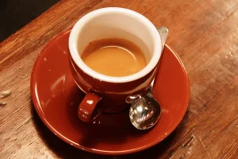
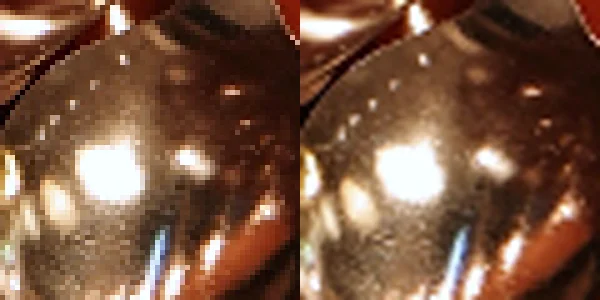
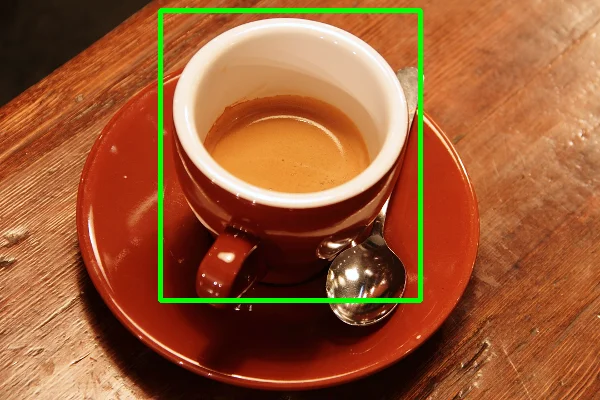
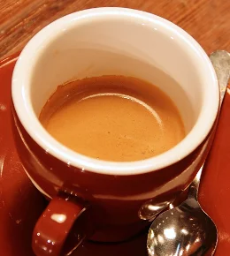
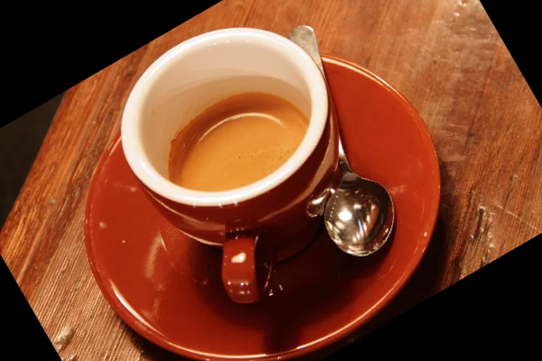
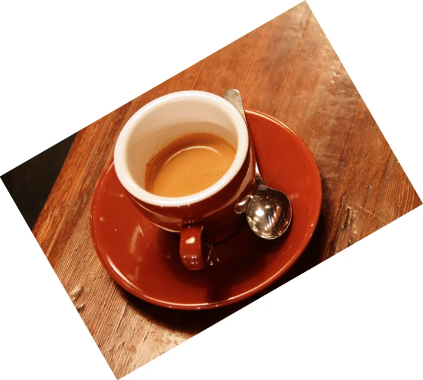
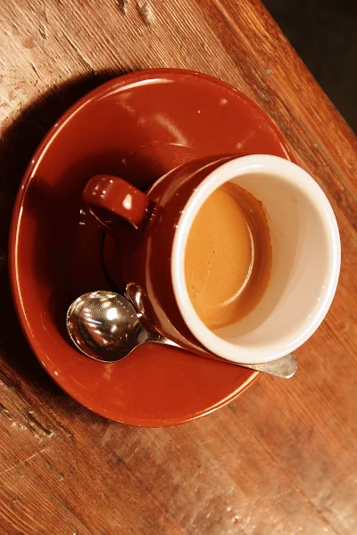
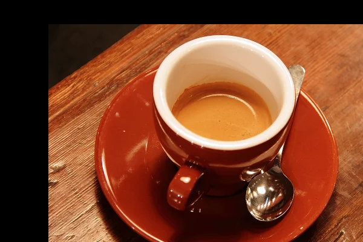
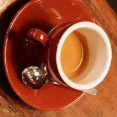

### Transformaciones Geométricas y Manipulación de Píxeles

Las transformaciones geométricas permiten alterar las dimensiones, orientación o perspectiva de las imágenes. En OpenCV, estas operaciones se realizan mapeando las coordenadas de la matriz original a una nueva matriz proyectada.

En esta lección vas a aplicar las tres transformaciones más usadas sobre una misma foto real: **escalado**, **recorte** y **rotación**. Para cada una vas a ver el antes y el después. Al final vas a combinarlas en un ejercicio de cierre.

### La imagen de trabajo y el sistema de coordenadas

Todos los ejemplos usan la misma foto: una taza de café de 600 × 400 píxeles. Descargala desde [cafe.png](/static/media/cursos/pdi/cafe.png) y guardala con el nombre `cafe.png` en la carpeta donde vas a ejecutar el código.


*Foto: Rachel Michetti, cortesía de Pikolo Espresso Bar. Licencia CC0, sin restricciones de copyright. Forma parte de los datos de ejemplo de scikit-image.*

Antes de transformar una imagen conviene conocer su tamaño. En OpenCV, una imagen es un arreglo de NumPy y su atributo `shape` devuelve primero el **alto** (filas), después el **ancho** (columnas) y por último los **canales**:

```python
import cv2

imagen = cv2.imread("cafe.png")
if imagen is None:
    raise FileNotFoundError("No se encontró cafe.png en la carpeta actual")

alto, ancho, canales = imagen.shape
print(f"Ancho: {ancho} px, alto: {alto} px, canales: {canales}")
# Ancho: 600 px, alto: 400 px, canales: 3
```

Para abreviar, los bloques siguientes omiten la comprobación de `None`. En tus programas conviene mantenerla, porque `cv2.imread` no lanza un error si no encuentra el archivo: devuelve `None`, y el fallo aparece recién en la línea siguiente, con un mensaje confuso.

El origen de coordenadas `(0, 0)` está en la **esquina superior izquierda**. La coordenada `x` crece hacia la derecha y la `y` crece hacia abajo. Tené presente este detalle, porque OpenCV usa dos convenciones distintas según la función:

| Contexto | Orden | Ejemplo |
|---|---|---|
| `imagen.shape` y slicing de NumPy | (alto, ancho) → (`y`, `x`) | `imagen[y1:y2, x1:x2]` |
| Tamaños y puntos en funciones de OpenCV | (ancho, alto) → (`x`, `y`) | `cv2.resize(imagen, (ancho, alto))` |

### Escalado con `cv2.resize`

Escalar es cambiar el tamaño de la imagen. Hay dos formas de indicarlo:

- con un **tamaño exacto** `(ancho, alto)`;
- con un **factor de escala** `fx` y `fy`, pasando `None` como tamaño.

```python
import cv2

imagen = cv2.imread("cafe.png")
alto, ancho = imagen.shape[:2]

# 1. Reducir al 50 % con un factor de escala
reducida = cv2.resize(imagen, None, fx=0.5, fy=0.5, interpolation=cv2.INTER_AREA)
print("Reducida:", reducida.shape)  # (200, 300, 3)

# 2. Fijar el ancho y calcular el alto para conservar la proporción
nuevo_ancho = 240
nuevo_alto = round(alto * nuevo_ancho / ancho)
miniatura = cv2.resize(imagen, (nuevo_ancho, nuevo_alto), interpolation=cv2.INTER_AREA)
print("Miniatura:", miniatura.shape)  # (160, 240, 3)

# 3. Error común: forzar un tamaño que no respeta la proporción deforma la imagen
deformada = cv2.resize(imagen, (300, 300), interpolation=cv2.INTER_AREA)
print("Deformada:", deformada.shape)  # (300, 300, 3)

cv2.imwrite("cafe-reducida.png", reducida)
cv2.imwrite("cafe-deformada.png", deformada)
```

**Antes:** la foto original de 600 × 400 px (arriba). **Después:**



*Reducida al 50 % (300 × 200 px). La imagen se ve igual, pero tiene la cuarta parte de los píxeles.*


*Forzada a 300 × 300 px. Como la proporción original es 3:2, la taza queda estirada. Para no deformar, calculá siempre una de las dos medidas a partir de la otra, como en el paso 2.*

#### Interpolación: cómo se inventan los píxeles nuevos

Al ampliar una imagen aparecen píxeles que no existían, y el método de **interpolación** decide su color. En este ejemplo se amplía cinco veces un detalle de 60 × 60 px (el reflejo de la cuchara) con dos métodos distintos:

```python
import cv2
import numpy as np

imagen = cv2.imread("cafe.png")
detalle = imagen[240:300, 330:390]  # recorte de 60 × 60 px

vecino = cv2.resize(detalle, None, fx=5, fy=5, interpolation=cv2.INTER_NEAREST)
cubica = cv2.resize(detalle, None, fx=5, fy=5, interpolation=cv2.INTER_CUBIC)

# np.hstack une las dos imágenes una al lado de la otra para compararlas
comparacion = np.hstack([vecino, cubica])
print("Comparación:", comparacion.shape)  # (300, 600, 3)
cv2.imwrite("cafe-interpolacion.png", comparacion)
```



*Izquierda: `INTER_NEAREST` repite el píxel más cercano y se ven bloques. Derecha: `INTER_CUBIC` calcula valores intermedios y el resultado es más suave.*

| Interpolación | Cuándo usarla |
|---|---|
| `cv2.INTER_AREA` | Para **reducir**: evita el aliasing (patrones extraños y bordes dentados). |
| `cv2.INTER_LINEAR` | Para ampliar con buen equilibrio entre calidad y velocidad. Es la opción por defecto. |
| `cv2.INTER_CUBIC` | Para **ampliar** con más calidad, a cambio de un cálculo más lento. |
| `cv2.INTER_NEAREST` | Para imágenes que no deben mezclar colores, como máscaras o etiquetas. |

### Recorte con slicing de NumPy

Recortar no necesita ninguna función de OpenCV: alcanza con seleccionar un rango de filas y columnas del arreglo. El orden es `imagen[y_inicio:y_fin, x_inicio:x_fin]`, es decir, **primero las filas (y) y después las columnas (x)**.

```python
import cv2

imagen = cv2.imread("cafe.png")

# Zona de la taza: filas 10 a 300 y columnas 160 a 420
y1, y2, x1, x2 = 10, 300, 160, 420
taza = imagen[y1:y2, x1:x2].copy()
print("Recorte:", taza.shape)  # (290, 260, 3)

# Para visualizar qué se recortó, se marca la zona sobre una copia de la original.
# cv2.rectangle recibe los puntos como (x, y) e incluye el punto final,
# mientras que el slicing lo excluye: por eso se usa x2 - 1 e y2 - 1.
marcada = imagen.copy()
cv2.rectangle(marcada, (x1, y1), (x2 - 1, y2 - 1), (0, 255, 0), 3)

cv2.imwrite("cafe-zona-recorte.png", marcada)
cv2.imwrite("cafe-recorte-taza.png", taza)
```

**Antes:** la zona a recortar, marcada en verde sobre la original.



**Después:** el recorte de 260 × 290 px.



> **¿Por qué `.copy()`?** El slicing de NumPy no crea una imagen nueva: devuelve una *vista* que comparte memoria con la original. Si dibujás sobre un recorte sin `.copy()`, también modificás la imagen original. Usá `.copy()` cada vez que vayas a editar el recorte por separado.

> **Recortes fuera de los límites.** NumPy no avisa si el rango se sale de la imagen: `imagen[300:500, 500:700]` devuelve un recorte de 100 × 100 px en lugar de 200 × 200, y un índice negativo cuenta desde el final. Si las coordenadas se calculan (por ejemplo, alrededor de un punto), limitálas antes de recortar con `x1 = max(0, x1)` y `x2 = min(ancho, x2)`, y lo mismo en `y`, y comprobá el `shape` del resultado.

### Rotación con matrices afines

Para rotar una imagen se construye una **matriz de transformación afín** de 2 × 3 con `cv2.getRotationMatrix2D(centro, ángulo, escala)` y se aplica con `cv2.warpAffine`. En OpenCV, un **ángulo positivo gira en sentido antihorario**.

```python
import cv2

imagen = cv2.imread("cafe.png")
alto, ancho = imagen.shape[:2]
centro = (ancho / 2, alto / 2)

# Matriz de rotación: 30 grados antihorario, sin cambiar la escala
matriz = cv2.getRotationMatrix2D(centro, 30, 1.0)
rotada = cv2.warpAffine(imagen, matriz, (ancho, alto))
print("Rotada:", rotada.shape)  # (400, 600, 3)

cv2.imwrite("cafe-rotada.png", rotada)
```



*Rotada 30° con el mismo tamaño de salida. Las esquinas de la foto quedan afuera y el espacio vacío se rellena de negro.*

#### Rotar sin perder las esquinas

Para conservar toda la imagen hay que calcular un lienzo más grande y desplazar la matriz para que el resultado quede centrado en él. El nuevo ancho y el nuevo alto salen del seno y el coseno del ángulo, que ya están dentro de la matriz. Se redondean hacia arriba con `math.ceil`: si se truncaran con `int()`, las puntas de la imagen rotada podrían quedar fuera del lienzo por una fracción de píxel.

```python
import math

import cv2

imagen = cv2.imread("cafe.png")
alto, ancho = imagen.shape[:2]
centro = (ancho / 2, alto / 2)
matriz = cv2.getRotationMatrix2D(centro, 30, 1.0)

coseno = abs(matriz[0, 0])
seno = abs(matriz[0, 1])
nuevo_ancho = math.ceil(alto * seno + ancho * coseno)  # 719,6 → 720
nuevo_alto = math.ceil(alto * coseno + ancho * seno)   # 646,4 → 647

# Desplazar la imagen para que quede centrada en el lienzo nuevo
matriz[0, 2] += nuevo_ancho / 2 - centro[0]
matriz[1, 2] += nuevo_alto / 2 - centro[1]

rotada_completa = cv2.warpAffine(
    imagen, matriz, (nuevo_ancho, nuevo_alto), borderValue=(255, 255, 255)
)
print("Rotada completa:", rotada_completa.shape)  # (647, 720, 3)

cv2.imwrite("cafe-rotada-completa.png", rotada_completa)
```



*Rotada 30° en un lienzo de 720 × 647 px con fondo blanco (`borderValue`). No se pierde ninguna parte de la foto.*

Para giros de 90° o 180° conviene `cv2.rotate`, que es exacto y no interpola:

```python
import cv2

imagen = cv2.imread("cafe.png")
girada = cv2.rotate(imagen, cv2.ROTATE_90_CLOCKWISE)
print("Girada 90°:", girada.shape)  # (600, 400, 3): el ancho y el alto se intercambian

cv2.imwrite("cafe-girada-90.png", girada)
```



*Girada 90° en sentido horario. La imagen pasa de 600 × 400 a 400 × 600 px sin bordes vacíos, porque cada píxel solo cambia de lugar. Las otras opciones son `cv2.ROTATE_90_COUNTERCLOCKWISE` y `cv2.ROTATE_180`.*

#### Traslación

La misma función `cv2.warpAffine` sirve para **trasladar** (desplazar) una imagen. La matriz tiene la forma `[[1, 0, tx], [0, 1, ty]]`, donde `tx` y `ty` son los píxeles que se mueve en `x` y en `y`:

```python
import cv2
import numpy as np

imagen = cv2.imread("cafe.png")
alto, ancho = imagen.shape[:2]

matriz = np.float32([[1, 0, 80], [0, 1, 40]])  # 80 px a la derecha y 40 px hacia abajo
trasladada = cv2.warpAffine(imagen, matriz, (ancho, alto))
print("Trasladada:", trasladada.shape)  # (400, 600, 3)

cv2.imwrite("cafe-trasladada.png", trasladada)
```



*Trasladada 80 px a la derecha y 40 px hacia abajo. Como el lienzo conserva el tamaño original, aparecen franjas negras arriba y a la izquierda, y se pierden 80 px del borde derecho y 40 px del inferior.*

### Ejercicio de cierre: miniatura cuadrada para un catálogo

Una tienda necesita una miniatura **cuadrada de 200 × 200 px** de cada foto de producto, sin deformarla. Además, para practicar los giros exactos, la miniatura debe quedar girada 90° en sentido horario. Partiendo de `cafe.png`:

1. Recortá el **cuadrado central más grande** posible. Su lado es la medida menor entre el ancho y el alto.
2. Reducí ese cuadrado a **200 × 200 px** con la interpolación adecuada para reducir.
3. Girá el resultado **90° en sentido horario**.
4. Comprobá con `assert` que la miniatura mide 200 × 200 px y tiene 3 canales, y guardala como `cafe-miniatura.png`.

Intentá resolverlo antes de mirar la solución.

**Solución:**

```python
import cv2

imagen = cv2.imread("cafe.png")
alto, ancho = imagen.shape[:2]

# 1. Cuadrado central: el lado es la medida menor
lado = min(alto, ancho)                # 400
y1 = (alto - lado) // 2                # 0
x1 = (ancho - lado) // 2               # 100
cuadrado = imagen[y1:y1 + lado, x1:x1 + lado].copy()

# 2. Reducir con INTER_AREA: como el recorte ya es cuadrado, no se deforma
miniatura = cv2.resize(cuadrado, (200, 200), interpolation=cv2.INTER_AREA)

# 3. Giro exacto de 90° en sentido horario
miniatura = cv2.rotate(miniatura, cv2.ROTATE_90_CLOCKWISE)

# 4. Comprobación
assert miniatura.shape == (200, 200, 3), miniatura.shape
cv2.imwrite("cafe-miniatura.png", miniatura)
print("Miniatura lista:", miniatura.shape)  # (200, 200, 3)
```

**Resultado esperado:**



**Para pensar:**

- ¿Qué pasaría si en el paso 2 redimensionaras la foto completa a 200 × 200 sin recortar antes?
- ¿Por qué en el paso 3 conviene `cv2.rotate` en lugar de `cv2.getRotationMatrix2D` con 90°?
- ¿La solución funciona sin cambios con una foto vertical, más alta que ancha? ¿Qué valores toman `y1` y `x1` en ese caso?

### Resumen

| Transformación | Función | Detalle clave |
|---|---|---|
| Escalado | `cv2.resize` | El tamaño va como (ancho, alto). Para no deformar, calculá una medida a partir de la otra. |
| Interpolación | parámetro `interpolation` | `INTER_AREA` para reducir; `INTER_LINEAR` o `INTER_CUBIC` para ampliar. |
| Recorte | slicing `imagen[y1:y2, x1:x2]` | Primero filas (y) y después columnas (x). Usá `.copy()` si vas a editar el recorte. |
| Rotación | `cv2.getRotationMatrix2D` + `cv2.warpAffine` | El ángulo positivo es antihorario. Agrandá el lienzo para no perder las esquinas. |
| Giros de 90° | `cv2.rotate` | Exacto y sin interpolación. |
| Traslación | `cv2.warpAffine` con `[[1, 0, tx], [0, 1, ty]]` | Desplaza la imagen `tx` píxeles en x y `ty` en y. |
