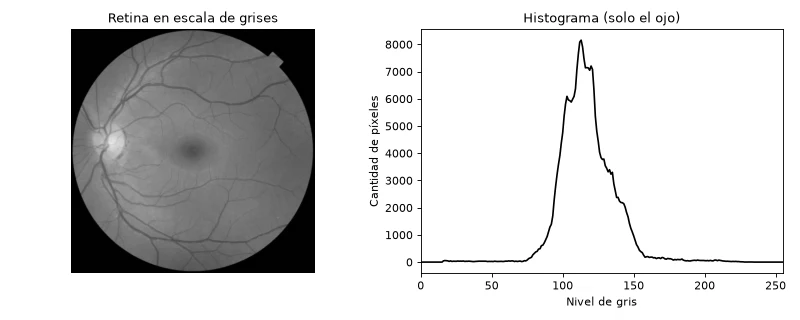
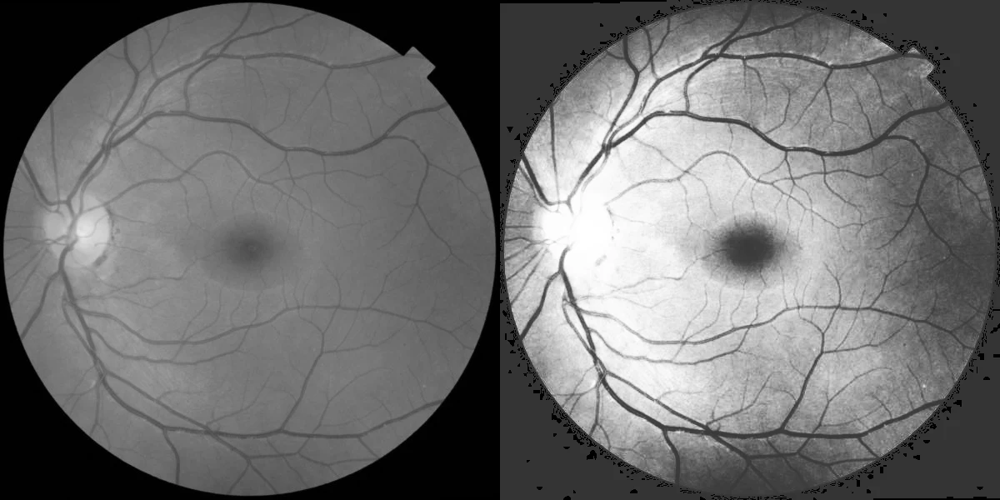
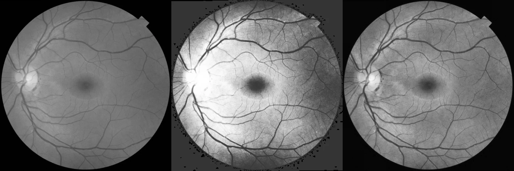
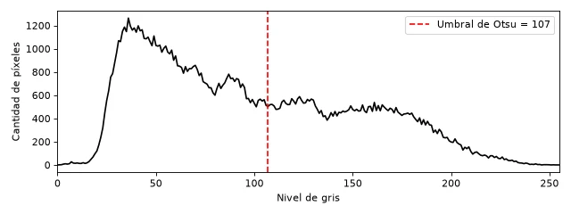
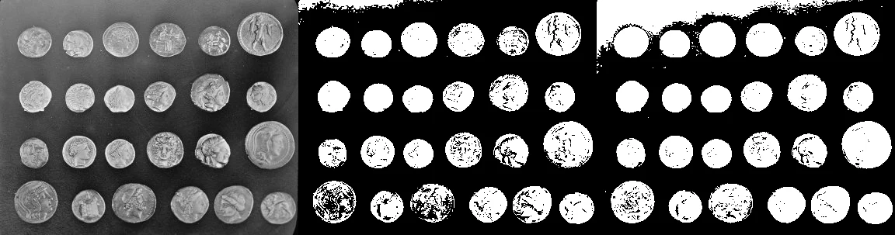
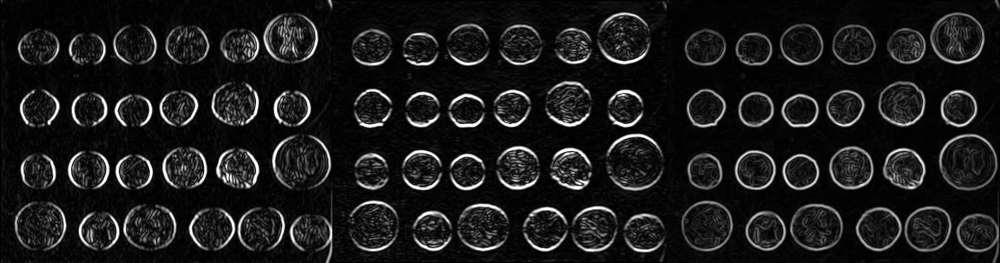
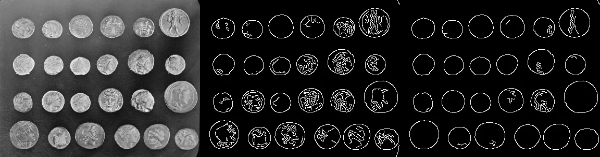

### Histogramas, Umbralización y Detección de Bordes

Para aislar un objeto en una imagen, primero hay que entender cómo se reparten sus niveles de gris. Esa es la información que da el **histograma**. A partir de él se puede **mejorar el contraste** (ecualización), **separar el objeto del fondo** (umbralización, con el método automático de Otsu) y **encontrar sus contornos** (bordes con Sobel y Canny).

En esta lección vas a aplicar cada técnica sobre fotos reales y vas a ver el antes y el después. Al final vas a programar el método de Otsu con NumPy y vas a comprobar que da el mismo umbral que OpenCV.

### Video: histogramas, brillo y contraste

Antes de empezar, mirá este video de un minuto y medio. Muestra qué le pasa al histograma cuando cambiás el brillo y el contraste de una foto, y adelanta la ecualización, CLAHE y el umbral de Otsu, que vas a programar en esta lección.

<video controls="controls" preload="none" poster="/static/media/cursos/pdi/video-histogramas-brillo-contraste.webp"><source src="/static/media/cursos/pdi/video-histogramas-brillo-contraste.mp4" type="video/mp4"></video>

*El video no tiene voz: las explicaciones aparecen escritas en pantalla y la música de fondo se generó por computadora. Todo lo que muestra se explica con más detalle en esta lección.*

### Las imágenes de trabajo

Descargá estas tres imágenes y guardalas, con estos nombres, en la carpeta donde vas a ejecutar el código:

| Archivo | Qué muestra | Para qué se usa |
|---|---|---|
| [retina.jpg](/static/media/cursos/pdi/retina.jpg) | Fondo de ojo, 600 × 600 px | Histograma y ecualización |
| [monedas.png](/static/media/cursos/pdi/monedas.png) | Monedas griegas sobre un fondo gris, 384 × 303 px | Umbral de Otsu y bordes |
| [texto.png](/static/media/cursos/pdi/texto.png) | Fórmulas escritas a mano, con luz despareja | Límites del umbral global |

*Fotos: «Fundus photograph of normal left eye», de Mikael Häggström (CC0); monedas de Pompeya de la colección del Brooklyn Museum (sin restricciones de copyright conocidas); texto manuscrito de Stéfan van der Walt (dominio público). Las tres forman parte de los datos de ejemplo de scikit-image. La retina se redujo de 1411 a 600 px.*

Los ejemplos usan `opencv-python`, `numpy` y `matplotlib`, que ya están en el `requirements.txt` de la lección 0.1.

### El histograma de una imagen

El histograma cuenta **cuántos píxeles hay de cada nivel de gris**, del 0 (negro) al 255 (blanco). No dice dónde están los píxeles, solo cuántos hay de cada tono. Con eso alcanza para saber si una imagen es oscura, clara o de poco contraste.

`cv2.calcHist` recibe cinco argumentos, siempre dentro de listas: las imágenes, el canal, una **máscara** opcional, la cantidad de intervalos (*bins*) y el rango de valores. La máscara sirve para contar solo una parte de la imagen. En la retina conviene usarla: el fondo negro alrededor del ojo no es parte de la foto que importa y, si se cuenta, tapa todo lo demás.

```python
import cv2
import matplotlib.pyplot as plt

retina = cv2.imread("retina.jpg", cv2.IMREAD_GRAYSCALE)
print("Tamaño:", retina.shape)  # (600, 600)

# Máscara: blanco (255) donde está el ojo y negro (0) en el fondo
mascara = cv2.inRange(retina, 16, 255)
print("Píxeles del ojo:", cv2.countNonZero(mascara))  # Píxeles del ojo: 276398

# Imágenes, canal, máscara, cantidad de intervalos y rango
hist = cv2.calcHist([retina], [0], mascara, [256], [0, 256])
print("Intervalos:", len(hist))  # Intervalos: 256
print("Nivel más frecuente:", int(hist.argmax()))  # Nivel más frecuente: 113

figura, (izq, der) = plt.subplots(1, 2, figsize=(10, 4))
izq.imshow(retina, cmap="gray", vmin=0, vmax=255)
izq.set_title("Retina en escala de grises")
izq.axis("off")
der.plot(hist, color="black")
der.set_xlim(0, 255)
der.set_title("Histograma (solo el ojo)")
der.set_xlabel("Nivel de gris")
der.set_ylabel("Cantidad de píxeles")
figura.tight_layout()
figura.savefig("retina-histograma.png", dpi=80)
```



El histograma es **una montaña angosta en el medio**: casi no hay negros ni blancos. Por eso la foto se ve gris y apagada, y los vasos sanguíneos finos casi no se distinguen del fondo. Así se ve una imagen de **poco contraste**.

### Ecualización del histograma

La ecualización **redistribuye los niveles de gris para que ocupen todo el rango**, del 0 al 255. Los tonos que se repiten mucho quedan más separados entre sí y los que casi no aparecen se juntan. El histograma resultante queda más parejo, más «plano», y el contraste aumenta.

La idea se basa en el **histograma acumulado**: para cada nivel de gris, qué porcentaje de píxeles tiene ese nivel o uno más oscuro. Si el 40 % de los píxeles es igual o más oscuro que el nivel 110, ese nivel pasa a valer el 40 % de 255, o sea 102. Cada nivel se reemplaza así por su posición en el ranking de brillo.

```python
import cv2
import numpy as np

retina = cv2.imread("retina.jpg", cv2.IMREAD_GRAYSCALE)
ecualizada = cv2.equalizeHist(retina)

# Rango que ocupa el 90 % central de los píxeles del ojo, antes y después
ojo = retina > 15
p5, p95 = np.percentile(retina[ojo], [5, 95])
print(f"Antes: del {p5:.0f} al {p95:.0f}")  # Antes: del 93 al 147
p5, p95 = np.percentile(ecualizada[ojo], [5, 95])
print(f"Después: del {p5:.0f} al {p95:.0f}")  # Después: del 66 al 246

cv2.imwrite("retina-ecualizada.png", cv2.hconcat([retina, ecualizada]))
```



Antes, el 90 % de los píxeles del ojo usaba solo **55 de los 256 niveles** (del 93 al 147). Después de ecualizar usa **181** (del 66 al 246), y los vasos sanguíneos se ven mucho más marcados.

Pero el resultado también muestra dos **problemas de la ecualización global**:

- **El fondo negro se volvió gris.** `cv2.equalizeHist` no acepta máscara: usa el histograma de toda la imagen, y el fondo es casi un cuarto de los píxeles. Por la compresión del JPG, el fondo no vale exactamente 0 sino entre 1 y 15, y la ecualización separa esos tonos casi negros hasta convertirlos en gris.
- **El disco óptico, la zona clara de la izquierda, quedó blanco quemado.** La ecualización aplica la misma regla a toda la foto, sin mirar qué pasa en cada zona.

### Ecualización adaptativa (CLAHE)

**CLAHE** (*Contrast Limited Adaptive Histogram Equalization*) resuelve los dos problemas:

- **Divide la imagen en cuadros** (por defecto, una grilla de 8 × 8) y ecualiza cada uno con su propio histograma. Así cada zona gana contraste según lo que tiene.
- **Limita el contraste** con `clipLimit`: ningún nivel de gris puede acaparar demasiado rango. Evita que el ruido de las zonas parejas se amplifique.

```python
import cv2
import numpy as np

retina = cv2.imread("retina.jpg", cv2.IMREAD_GRAYSCALE)
global_ = cv2.equalizeHist(retina)

clahe = cv2.createCLAHE(clipLimit=2.0, tileGridSize=(8, 8))
adaptativa = clahe.apply(retina)

# Nivel de gris típico (mediana) del fondo, en cada versión
fondo = retina <= 15
print("Fondo original:", int(np.median(retina[fondo])))  # Fondo original: 1
print("Fondo con ecualización global:", int(np.median(global_[fondo])))  # Fondo con ecualización global: 52
print("Fondo con CLAHE:", int(np.median(adaptativa[fondo])))  # Fondo con CLAHE: 6

cv2.imwrite("retina-clahe.png", cv2.hconcat([retina, global_, adaptativa]))
```



Con CLAHE los vasos se ven más marcados que en la original, aunque menos que con la ecualización global. A cambio, **el fondo sigue casi negro** (6 en lugar de 52) **y el disco óptico conserva su detalle**.

| Técnica | Cuándo conviene |
|---|---|
| `cv2.equalizeHist` | Imágenes con la iluminación pareja y sin grandes zonas de un solo color. Es simple y rápida. |
| CLAHE | Fotos con zonas muy claras y muy oscuras a la vez, como imágenes médicas, satelitales o tomadas a contraluz. |

### Umbralización: de grises a blanco y negro

**Umbralizar** es convertir la imagen en binaria: cada píxel pasa a blanco (255) si supera un valor, el **umbral**, y a negro (0) si no. Es la forma más directa de separar un objeto del fondo, por ejemplo para contar las monedas de una foto o medir su tamaño.

`cv2.threshold` devuelve dos cosas: el umbral que usó y la imagen binaria. El problema es **elegir el umbral**. Con un valor fijo, como 127, el resultado depende de que la foto tenga justo ese brillo.

### El método de Otsu

El método de Otsu **elige el umbral automáticamente**. Prueba todos los umbrales posibles, del 0 al 255, y en cada uno divide los píxeles en dos grupos: los oscuros (fondo) y los claros (objeto). Se queda con el umbral que **separa mejor los dos grupos**: el que deja cada grupo lo más parejo posible por dentro y los dos grupos lo más distintos posible entre sí.

Funciona mejor cuando el histograma tiene **dos grupos de tonos bien distintos**, uno para el fondo y otro para el objeto. El caso ideal son dos montañas: el umbral cae en el valle entre las dos.

Para usarlo, se suma `cv2.THRESH_OTSU` al tipo de umbral y se pasa `0` como umbral, porque OpenCV lo va a calcular:

```python
import cv2
import matplotlib.pyplot as plt

monedas = cv2.imread("monedas.png", cv2.IMREAD_GRAYSCALE)

# Umbral fijo, elegido a ojo
_, fijo = cv2.threshold(monedas, 127, 255, cv2.THRESH_BINARY)

# Umbral de Otsu: se pasa 0 y OpenCV devuelve el que calculó
umbral, otsu = cv2.threshold(monedas, 0, 255, cv2.THRESH_BINARY + cv2.THRESH_OTSU)
print("Umbral de Otsu:", umbral)  # Umbral de Otsu: 107.0

cv2.imwrite("monedas-umbral.png", cv2.hconcat([monedas, fijo, otsu]))

# Histograma con el umbral marcado
hist = cv2.calcHist([monedas], [0], None, [256], [0, 256])
figura, eje = plt.subplots(figsize=(8, 3))
eje.plot(hist, color="black")
eje.axvline(umbral, color="red", linestyle="--", label=f"Umbral de Otsu = {umbral:.0f}")
eje.set_xlim(0, 255)
eje.set_xlabel("Nivel de gris")
eje.set_ylabel("Cantidad de píxeles")
eje.legend()
figura.tight_layout()
figura.savefig("monedas-histograma-otsu.png", dpi=80)
```





En el histograma, el fondo oscuro forma la montaña de la izquierda y las monedas, la meseta de la derecha. Otsu eligió **107**, justo donde termina la montaña.

Con el umbral fijo de 127, las partes más oscuras de las monedas caen del lado del fondo y **varias monedas quedan incompletas**. Con el de Otsu, las monedas aparecen **mucho más enteras**. Pero mirá la franja de arriba: esa parte del fondo está más iluminada, supera el 107 y **también queda blanca**. Es el límite de usar un solo umbral para toda la foto, que se ve en la sección siguiente.

### Cuándo no alcanza un solo umbral

Otsu calcula **un único umbral para toda la imagen**. Si la iluminación es despareja, el fondo de una zona puede ser más oscuro que el objeto de otra, y ningún umbral único sirve. En esos casos se usa la **umbralización adaptativa**: `cv2.adaptiveThreshold` calcula un umbral distinto para cada píxel, a partir de sus vecinos.

```python
import cv2

texto = cv2.imread("texto.png", cv2.IMREAD_GRAYSCALE)

umbral, otsu = cv2.threshold(texto, 0, 255, cv2.THRESH_BINARY + cv2.THRESH_OTSU)
print("Umbral de Otsu:", umbral)  # Umbral de Otsu: 109.0

# Umbral de cada píxel: el promedio de un vecindario de 35 × 35, menos 10
adaptativa = cv2.adaptiveThreshold(
    texto, 255, cv2.ADAPTIVE_THRESH_MEAN_C, cv2.THRESH_BINARY, 35, 10
)

cv2.imwrite("texto-otsu-vs-adaptativa.png", cv2.vconcat([texto, otsu, adaptativa]))
```


Con Otsu, **la parte de arriba de la hoja, que está más oscura, se llena de manchas negras** y las fórmulas se mezclan con ellas. Con el umbral adaptativo, cada zona se compara con su propio entorno y **el texto se lee en toda la hoja**, aunque quedan algunas manchas chicas.

### Detección de bordes: Sobel

Un **borde** es un lugar donde el brillo cambia de golpe. El filtro **Sobel** mide ese cambio, el **gradiente**, en una dirección:

- con `dx=1, dy=0` mide los cambios horizontales y resalta los bordes **verticales**;
- con `dx=0, dy=1` mide los cambios verticales y resalta los bordes **horizontales**.

Las dos direcciones se combinan en la **magnitud del gradiente**, que marca los bordes en cualquier dirección. Antes conviene suavizar con un filtro gaussiano, como viste en la lección 2.1, para que el ruido no se confunda con bordes.

```python
import cv2

monedas = cv2.imread("monedas.png", cv2.IMREAD_GRAYSCALE)
suavizada = cv2.GaussianBlur(monedas, (5, 5), 0)

# CV_64F: el gradiente puede ser negativo y no entra en uint8
sobel_x = cv2.Sobel(suavizada, cv2.CV_64F, 1, 0, ksize=3)
sobel_y = cv2.Sobel(suavizada, cv2.CV_64F, 0, 1, ksize=3)
magnitud = cv2.magnitude(sobel_x, sobel_y)
print("Tipo del resultado:", magnitud.dtype)  # Tipo del resultado: float64

# Para guardarlas: valor absoluto y escala de 0 a 255
vista_x = cv2.convertScaleAbs(sobel_x)
vista_y = cv2.convertScaleAbs(sobel_y)
vista_magnitud = cv2.normalize(magnitud, None, 0, 255, cv2.NORM_MINMAX).astype("uint8")

cv2.imwrite("monedas-sobel.png", cv2.hconcat([vista_x, vista_y, vista_magnitud]))
```



Fijate que el resultado de `cv2.Sobel` es `float64`: el gradiente es **negativo** cuando el brillo baja, y `uint8` no tiene negativos. Por eso, para verlo como imagen, hay que tomar el valor absoluto (`cv2.convertScaleAbs`) o escalarlo (`cv2.normalize`).

### Detección de bordes: Canny

**Canny** es el detector de bordes más usado. Parte del gradiente de Sobel y agrega tres etapas:

1. **Suavizado gaussiano** para reducir el ruido.
2. **Supresión de no máximos:** de cada borde grueso deja solo la línea de un píxel donde el gradiente es máximo.
3. **Umbral con histéresis:** usa dos umbrales. Un píxel con gradiente mayor que el **superior** es borde seguro; uno menor que el **inferior** se descarta; y uno intermedio se acepta solo si toca un borde seguro.

El resultado es una imagen binaria con bordes finos y continuos. Los dos umbrales controlan cuánto detalle aparece:

```python
import cv2

monedas = cv2.imread("monedas.png", cv2.IMREAD_GRAYSCALE)
suavizada = cv2.GaussianBlur(monedas, (5, 5), 0)

detallado = cv2.Canny(suavizada, threshold1=50, threshold2=150)
limpio = cv2.Canny(suavizada, threshold1=100, threshold2=250)
print("Píxeles de borde con 50 y 150:", cv2.countNonZero(detallado))  # Píxeles de borde con 50 y 150: 8513
print("Píxeles de borde con 100 y 250:", cv2.countNonZero(limpio))  # Píxeles de borde con 100 y 250: 4660

cv2.imwrite("monedas-canny.png", cv2.hconcat([monedas, detallado, limpio]))
```



Con umbrales bajos aparecen también los **detalles del relieve** de cada moneda. Con umbrales altos queda casi solo el **contorno exterior**. Cuál conviene depende de qué quieras hacer después: para contar las monedas alcanza el contorno; para reconocer qué figura tiene cada una hace falta el detalle.

> **Consejo práctico:** antes de usar `cv2.Canny`, suavizá la imagen con `cv2.GaussianBlur`. Sin ese paso, el ruido genera bordes falsos. Una regla habitual es que el umbral superior sea entre 2 y 3 veces el inferior.

### Ejercicio de cierre: el método de Otsu con NumPy

**Consigna:** programá el método de Otsu sin usar `cv2.THRESH_OTSU` y comprobá que, para `monedas.png`, da el mismo umbral que OpenCV.

Para cada umbral posible `t`, dividí los píxeles en dos grupos (los de nivel menor o igual que `t` y los mayores) y calculá:

- `w0` y `w1`: la proporción de píxeles de cada grupo;
- `m0` y `m1`: el nivel de gris promedio de cada grupo;
- la **varianza entre grupos**, `w0 * w1 * (m0 - m1) ** 2`.

Otsu elige el `t` con la mayor varianza entre grupos: es el que deja los dos grupos más separados.

**Solución:**

```python
import cv2
import numpy as np

monedas = cv2.imread("monedas.png", cv2.IMREAD_GRAYSCALE)

# Histograma normalizado: proporción de píxeles de cada nivel de gris
hist = np.bincount(monedas.ravel(), minlength=256) / monedas.size
niveles = np.arange(256)

mejor_t, mejor_varianza = 0, 0.0
for t in range(256):
    w0 = hist[: t + 1].sum()
    w1 = 1 - w0
    if w0 == 0 or w1 == 0:
        continue  # uno de los grupos está vacío
    m0 = (niveles[: t + 1] * hist[: t + 1]).sum() / w0
    m1 = (niveles[t + 1 :] * hist[t + 1 :]).sum() / w1
    varianza = w0 * w1 * (m0 - m1) ** 2
    if varianza > mejor_varianza:
        mejor_t, mejor_varianza = t, varianza

umbral_opencv, _ = cv2.threshold(monedas, 0, 255, cv2.THRESH_BINARY + cv2.THRESH_OTSU)
print("Otsu con NumPy:", mejor_t)  # Otsu con NumPy: 107
print("Otsu con OpenCV:", int(umbral_opencv))  # Otsu con OpenCV: 107
assert mejor_t == int(umbral_opencv)
```

**Para pensar:**

- ¿Qué umbral da tu función para `texto.png`? ¿Coincide con el de OpenCV? ¿Por qué el resultado igual no sirve para leer las fórmulas?
- Si el histograma tuviera una sola montaña, como la retina, ¿qué pasaría con el umbral de Otsu?

### Resumen

| Técnica | Función de OpenCV | Para qué sirve |
|---|---|---|
| Histograma | `cv2.calcHist` | Ver cómo se reparten los niveles de gris y diagnosticar el contraste |
| Ecualización global | `cv2.equalizeHist` | Estirar el contraste de una imagen con iluminación pareja |
| Ecualización adaptativa | `cv2.createCLAHE` | Mejorar el contraste por zonas sin quemar las claras ni amplificar el ruido |
| Umbral fijo | `cv2.threshold` con `THRESH_BINARY` | Binarizar cuando el brillo de la escena es conocido |
| Umbral de Otsu | `cv2.threshold` con `THRESH_OTSU` | Elegir el umbral solo, cuando fondo y objeto tienen tonos bien distintos |
| Umbral adaptativo | `cv2.adaptiveThreshold` | Binarizar con iluminación despareja |
| Sobel | `cv2.Sobel` y `cv2.magnitude` | Medir el gradiente en cada dirección |
| Canny | `cv2.Canny` | Obtener bordes finos y continuos |
