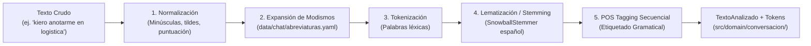

# Análisis Morfológico y Pipeline de Texto — Widget Conversacional (Eje 1.2)

Documento técnico curricular correspondiente a la unidad curricular **Técnicas de Procesamiento del Habla** (Res. DGCyE N.° 2730/22, Trayecto F, unidad curricular 11), en el marco del desarrollo del motor conversacional del **ISFT N° 199**.

---

## 1. Etapas del Pipeline de Análisis Morfológico

El procesamiento de la consulta del usuario se estructura en cuatro etapas secuenciales, implementadas en `src/application/services/text_morphology_service.py` y delegadas a través del puerto `NLPProcessorGateway`:

---

## 2. Justificación Técnica: Lematización vs. Stemming en Español

Para el contexto del portal institucional y el entorno de despliegue en un VPS de producción con recursos compartidos:

1. **Elección adoptada:** **Stemming en español basado en el algoritmo Snowball (Porter 2)** provisto por NLTK, complementado con un diccionario de expansión y normalización de modismos locales (`data/chat/abreviaturas.yaml`).
2. **Razones de la elección:**
   - **Eficiencia y Consumo ($0 recursos / bajo footprint):** Los lematizadores basados en modelos neuronales profundos (como los modelos transformer de spaCy `es_core_news_lg` o Stanza) requieren cientos de megabytes de descarga en memoria RAM y añaden latencia innecesaria para consultas institucionales frecuentes.
   - **Morfología flexiva del español:** El algoritmo Snowball reduce de forma confiable sufijos verbales, de género y de número (ej. *"carreras"* $\rightarrow$ *"carrer"*, *"inscribirme"* $\rightarrow$ *"inscrib"*), permitiendo un emparejamiento semántico preciso y de alto rendimiento.
   - **Independencia en Dominio:** Toda la lógica de transformación opera detrás del puerto `NLPProcessorGateway` (`src/application/gateways/nlp_gateway.py`), lo que permite reemplazar el motor por un lematizador más pesado si la infraestructura futura lo requiere, sin modificar el dominio ni los casos de uso.

---

## 3. Etiquetado Gramatical (POS Tagging) como Problema Secuencial

El etiquetado morfofisiológico (Part-of-Speech Tagging) asigna a cada token una categoría gramatical (Sustantivo, Verbo, Adjetivo, Adverbio, Determinante, Pronombre, etc.). En esta etapa se implementa un etiquetador estricto por reglas morfológicas y afijos característicos de la lengua española (desinencias verbales `-ar`, `-er`, `-ir`, sufijos adjetivales `-al`, `-oso`, etc.) para nutrir las gramáticas formales y la extracción de intenciones del Eje 1.3.

---

## 4. Desacoplamiento de Datos (AGENTS.md §3)

- **Stopwords:** Residen exclusivamente en `data/chat/stopwords.yaml`.
- **Abreviaturas y Modismos:** Residen exclusivamente en `data/chat/abreviaturas.yaml` (ej. `q` $\rightarrow$ `que`, `xq` $\rightarrow$ `por que`, `kiero` $\rightarrow$ `quiero`, `info` $\rightarrow$ `informacion`).
- **Dominio:** `src/domain/conversacion/` solo contiene clases puras `@dataclass(frozen=True)` (`Token` y `TextoAnalizado`).
