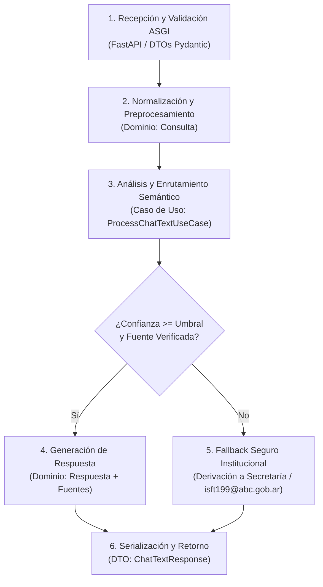

# Arquitectura y Fases de la Comunicación — Widget Conversacional (Eje 1)

Documento técnico correspondiente a la unidad curricular **Técnicas de Procesamiento del Habla** (Res. DGCyE N.° 2730/22, Trayecto F, unidad curricular 11), en el marco del desarrollo del motor de procesamiento de lenguaje natural para el portal institucional del **ISFT N° 199**.

---

## 1. Fases de la Comunicación Usuario-Sistema

La interacción escrita entre el aspirante/estudiante y el asistente conversacional sigue un modelo estructurado por etapas delimitadas para garantizar previsibilidad, robustez y adhesión estricta a la veracidad institucional (AGENTS.md §7.5).

### Detalle de cada Fase

1. **Fase 1: Recepción y Validación del Mensaje**
   - **Objetivo:** Capturar la petición HTTP entrante (`POST /api/v1/chat/text`), validar formato y aplicar restricciones perimetrales.
   - **Componente:** `src/infrastructure/fastapi/routes/chat_routes.py` y `src/application/dtos/chat_dto.py` (`ChatTextRequest`).
   - **Reglas:**
     - Longitud mínima: 1 carácter no vacío (`min_length=1`).
     - Longitud máxima: 1000 caracteres (`max_length=1000`).
     - Peticiones vacías o que superen el límite devuelven `HTTP 422 Unprocessable Entity`.

2. **Fase 2: Normalización y Modelado de Dominio**
   - **Objetivo:** Instanciar la entidad inmutable de consulta en el lenguaje ubicuo del dominio.
   - **Componente:** `src/domain/conversacion/consulta.py` (`Consulta`).
   - **Reglas:** Desacoplado de frameworks web o bases de datos; modelado puro con `@dataclass(frozen=True)`.

3. **Fase 3: Análisis Semántico e Inferencia**
   - **Objetivo:** Determinar la intención del usuario y seleccionar el contenido de respuesta adecuado.
   - **Componente:** `src/application/use_cases/chat/process_chat_text_use_case.py` (`ProcessChatTextUseCase`).
   - **Implementación actual (Scaffolding / Eje 1.1):** Lectura desacoplada de la respuesta simulada desde `data/chat/mock_response.yaml`. En las etapas posteriores (Eje 1.2, 1.3 y Eje 3) este componente orquesta el análisis léxico-morfológico, gramáticas formales y recuperación de información.

4. **Fase 4: Generación y Validación de Veracidad Institucional**
   - **Objetivo:** Construir la respuesta garantizando que los datos deriven exclusivamente de fuentes oficiales del instituto (`/carreras`, `/contacto`, etc.).
   - **Componente:** `src/domain/conversacion/respuesta.py` (`Respuesta`).
   - **Reglas:** Si el dato no existe o la confianza es insuficiente, se aplica el protocolo de derivación a Secretaría (`isft199@abc.gob.ar`).

5. **Fase 5: Entrega al Cliente (Widget Conversacional)**
   - **Objetivo:** Serializar la entidad de respuesta al contrato acordado para el frontend.
   - **Componente:** `ChatTextResponse` (`reply`, `intent`, `sources`, `confidence`).

---

## 2. Contrato de Integración y Endpoints

| Método | Ruta | Propósito | Salida |
| :--- | :--- | :--- | :--- |
| `GET` | `/api/v1/chat/health` | Estado del motor y módulos activos | `{ "status": "ok", "modules": { ... } }` |
| `POST` | `/api/v1/chat/text` | Procesamiento de consulta escrita | `{ "reply": "...", "intent": "...", "sources": [...], "confidence": 1.0 }` |
| `POST` | `/api/v1/chat/audio` | Procesamiento de nota de voz (Eje 2) | `{ "transcript": "...", "reply": "...", ... }` |

---

## 3. Mapeo Arquitectónico (Clean Architecture & DDD)

- **Dominio (`src/domain/conversacion/`):**
  - `Consulta`: Representa el mensaje y sesión del usuario.
  - `Respuesta`: Representa el mensaje saliente, intención, fuentes y score de confianza.
  - `SesionConversacion`: Agregado que almacena el historial cronológico de la interacción.
- **Aplicación (`src/application/`):**
  - `dtos/chat_dto.py`: Validación de entrada/salida ASGI.
  - `use_cases/chat/process_chat_text_use_case.py`: Orquestador de la consulta y estado del servicio.
- **Infraestructura (`src/infrastructure/`):**
  - `fastapi/routes/chat_routes.py`: Rutas FastAPI delegando al caso de uso.
- **Datos (`data/chat/`):**
  - `mock_response.yaml`: Configuración de módulos y plantilla de respuesta simulada inicial.
