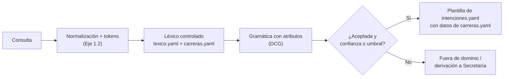

# Análisis semántico, léxico institucional y gramáticas formales (Eje 1.3)

Unidad curricular **Técnicas de Procesamiento del Habla** · Parte de #129 · Issue #132.

## 1. Pipeline



| Componente | Archivo |
|---|---|
| Léxico controlado | `data/chat/lexico.yaml` |
| Intenciones y respuestas | `data/chat/intenciones.yaml` |
| Fuente de verdad de carreras (solo lectura) | `data/content/carreras.yaml` |
| Símbolos, entidades e interpretación (dominio) | `src/domain/conversacion/interpretacion.py` |
| Etiquetado léxico | `src/application/services/lexico_institucional_service.py` |
| Gramática | `src/application/services/gramatica_intenciones_service.py` |
| Respuestas | `src/application/services/respuestas_chat_service.py` |

## 2. Léxico de la gramática

El léxico asigna a cada palabra o expresión una **categoría preterminal**. Se busca primero la expresión más
larga ("mesa de examen" antes que "mesa") y, para palabras sueltas, también por raíz (stem del Eje 1.2), lo
que cubre variantes como *inscribimos* → `inscripcion`. Los títulos oficiales de las carreras se leen de
`carreras.yaml`; `lexico.yaml` solo agrega alias coloquiales asociados a cada slug.

| Categoría | Ejemplos | Valor semántico |
|---|---|---|
| `saludo` | hola, buenas tardes | — |
| `pedido` | quiero, necesito, cuales, hay | — |
| `nucleo` | carrera, tecnicatura | se habla de la oferta |
| `tramite(T)` | anotarme, materias, mesa de examen, beca | `T` = intención |
| `carrera(C)` | logística, rrhh, ciencia de datos | `C` = slug oficial |
| `ord(N)` | primer, 2do, tercero | `N` = 1, 2, 3 |
| `marca_anio` | año | — |
| `ruido` | palabras de contenido desconocidas | baja la confianza |

## 3. Gramática (DCG)

```prolog
consulta(I, E)  --> cuerpo(E0), { resolver(E0, I, E) }.
cuerpo(E)       --> [] .
cuerpo(E)       --> elemento(E1), cuerpo(E2), { unificar(E1, E2, E) }.

elemento(t(T))  --> [tramite(T)].
elemento(c(C))  --> [carrera(C)].
elemento(a(N))  --> anio(N).
elemento(n)     --> [nucleo].
elemento(s)     --> [saludo].
elemento(vacio) --> [pedido] ; [ruido] ; [ord(_)] ; [marca_anio].

anio(N)         --> [ord(N)], [marca_anio].     % "primer año"
anio(N)         --> [marca_anio], [ord(N)].     % "año 1"
```

`unificar/3` combina las estructuras de rasgos `{tramite, carrera, anio}` y **falla** si un mismo rasgo
recibe dos valores distintos. `resolver/3` decide la intención:

1. Hay `tramite(T)` → intención `T` (regla `consulta_tramite`, confianza base 0,90).
2. Hay `carrera(C)` o `nucleo` → `info_carrera` (regla `consulta_carrera`, 0,85).
3. Solo `saludo` → `saludo` (0,95).
4. Ninguno → consulta rechazada (`sin_nucleo`).

La confianza final es `base × (0,5 + 0,5 × cobertura)`, donde la cobertura es la proporción de palabras de
contenido reconocidas por el léxico. Si queda por debajo de `umbral_confianza` (0,6) se deriva a Secretaría.

### Caso resuelto

Consulta: **"cuáles son las materias de primer año de turismo"**

```
normalizada : cuales son las materias de primer año de turismo
símbolos    : pedido pedido tramite(plan_estudios) ord(1) marca_anio carrera(turismo)

consulta(plan_estudios, {carrera: turismo, anio: 1})
└── cuerpo
    ├── elemento(vacio)            ← [pedido]          "cuales"
    ├── elemento(vacio)            ← [pedido]          "son"
    ├── elemento(t(plan_estudios)) ← [tramite]         "materias"
    ├── elemento(a(1))
    │   └── anio(1)                ← [ord(1)] [marca_anio]  "primer año"
    └── elemento(c(turismo))       ← [carrera]         "turismo"
```

La interpretación es correcta, pero `intenciones.yaml` no define `reply_anio` para `plan_estudios` porque el
sitio no publica el plan por año. Entonces el motor **deriva a Secretaría** en lugar de inventar materias.

## 4. Frases aceptadas y rechazadas

| Consulta | Resultado | Regla |
|---|---|---|
| kiero anotarme en logistica | `inscripcion`, carrera `logistica` | consulta_tramite |
| q carreras tienen a la noche | `horarios` | consulta_tramite |
| cuanto dura la tecnicatura en ciencia de datos | `duracion`, carrera `ciencia-de-datos-ia` | consulta_tramite |
| materias de logistica del año 1 | `plan_estudios`, año 1 → derivación | consulta_tramite |
| hay becas? | `becas` → derivación (sin datos en `data/`) | consulta_tramite |
| que carreras hay | `info_carrera` (lista de carreras) | consulta_carrera |
| Hola, buenas tardes | `saludo` | saludo |
| **horarios de logistica y de turismo** | rechazada: dos carreras | conflicto_entidades |
| **inscripcion y becas** | rechazada: dos trámites | conflicto_entidades |
| **materias de primer año y de segundo año** | rechazada: dos años | conflicto_entidades |
| **primer año** | rechazada: sin trámite ni carrera | sin_nucleo |
| **me gusta el futbol** | rechazada: fuera de dominio | sin_nucleo |

Las intenciones `correlatividades`, `mesas_examen` y `becas` no tienen datos publicados en `data/`, por lo que
siempre derivan a Secretaría (AGENTS.md §7.5).

## 5. Cómo probarlo

```bash
pytest tests/test_chat_lexico.py tests/test_chat_gramatica.py tests/test_chat_respuestas.py
curl -X POST http://localhost:8000/api/v1/chat/text \
  -H "Content-Type: application/json" \
  -d '{"session_id": "demo", "message": "kiero anotarme en logistica"}'
```

## 6. Limitaciones conocidas

- La expansión de abreviaturas del Eje 1.2 se aplica antes de quitar la puntuación, por lo que "rrhh?" (con el
  signo pegado) no se expande.
- La gramática acepta una sola carrera, un solo año y un solo trámite por consulta; las consultas compuestas se
  rechazan y se pide reformularlas.
